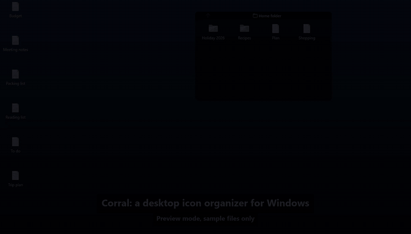
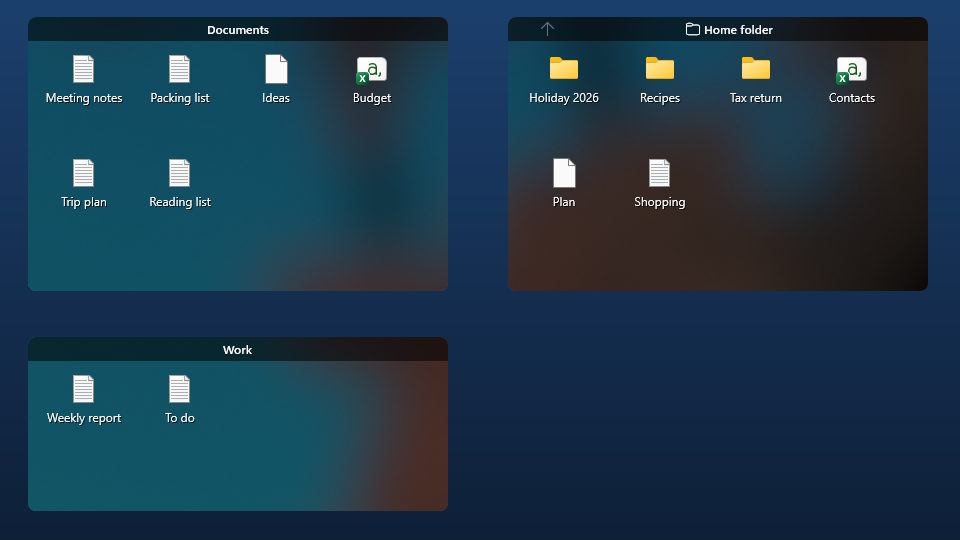
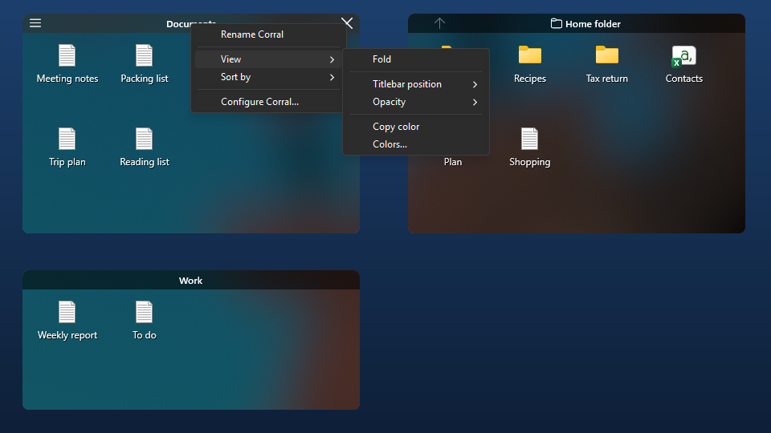
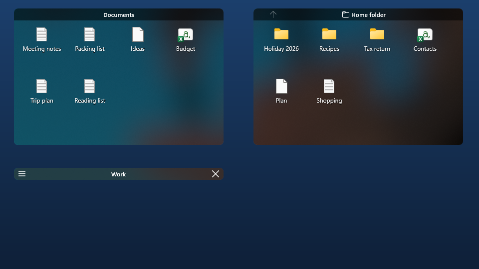
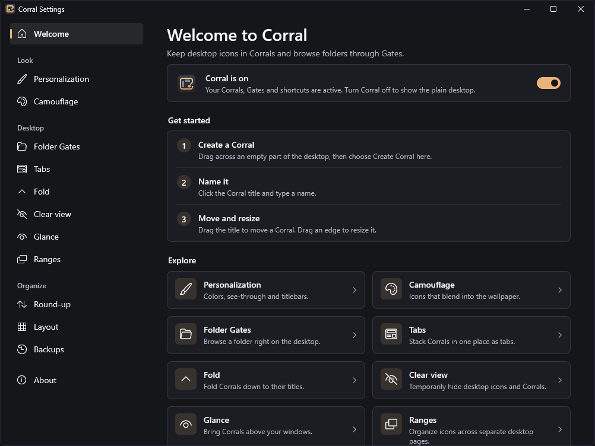
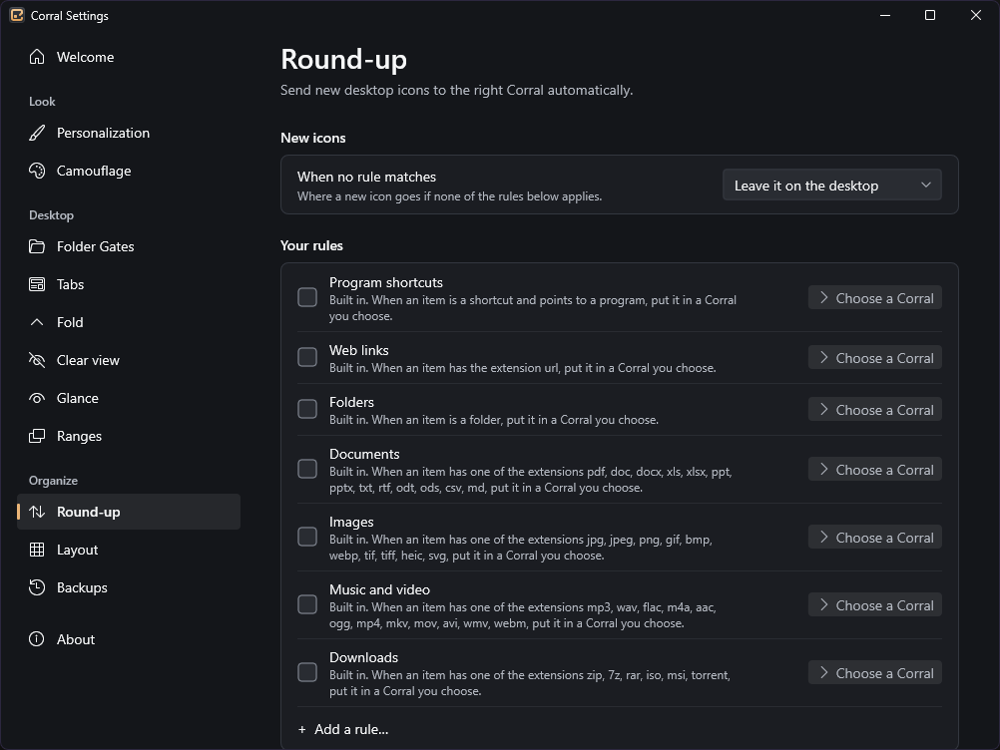

# Corral

**A desktop icon organizer for Windows, built as a personal project with AI coding agents.**

**Status: alpha.** The features below work and have been tested live on Windows 11, but expect
rough edges; see [Known issues](#known-issues). Download: [v0.1.0-alpha](https://github.com/threppo/corral/releases/tag/v0.1.0-alpha).



57-second demo with sample files ([MP4](https://github.com/threppo/corral/releases/download/v0.1.0-alpha/corral-demo.mp4), [how it was recorded](docs/showcase/demo-script.md)).

Corral keeps the desktop tidy with a set of building blocks you arrange yourself:

- **Corrals**: movable, resizable containers that hold desktop items.
- **Folder Gates**: a corral that shows a folder and lets you browse it without opening a window.
- **Views**: every Corral and Gate shows its items as Icons, List or Details (sortable, resizable
  columns: Name, Size, Type, Date modified).
- **Tabs**: stack several Corrals and Gates in one place and switch between them; with the Rounded
  style each tab gets its own rounded title bar with its own menu, close and Up buttons.
- **Camouflage**: icons take on the colours of the wallpaper behind them, for a quieter desktop.
- **Round-up**: rules that send new desktop items to the right corral, with a preview before sorting.
- **Saved desk setups**: corral placements remembered per monitor setup and restored when it returns.
- **Clear view**: double-click the desktop to hide corrals and icons, and again to bring them back.
- **Fold**: roll a corral up to just its title bar.
- **Ranges**: separate desktop pages you switch between.
- **Glance**: bring all corrals above your windows with a hotkey.

Arranging items in corrals and Round-up never move, rename or delete your files; corrals only
reference items on your desktop. Dropping files onto a Folder Gate is an ordinary Windows move
into that folder.

## More screenshots



| | |
| --- | --- |
|  |  |
| The Corral menu | A folded Corral |
|  |  |
| Settings: Welcome | Settings: Round-up rules for new icons |

[Settings: Glance shortcuts](assets/screenshots/settings-glance.png). All screenshots use throwaway
sample files.

## My role and AI workflow

I built Corral between 10 and 29 October 2026 with Claude Code and Codex, in a private repository
(about 690 commits). This public repository starts from a single snapshot of that work, so its
history is short on purpose.

**What I did**

- Set the goal and the limits: a native Windows app in Rust that must never lose or move a user's
  files without them asking.
- Made the product decisions the agents brought to me, for example: Corral's own names for every
  feature, the amber accent and the app icon (picked from design options), size snapping off by
  default because resizing felt too snappy, Corrals using the desktop's icon spacing, allowing a
  keyboard hook so Glance shortcuts work everywhere, and the GPL licence.
- Tested by hand in the first week: preview sessions and a two-monitor session in desktop mode
  (switching displays with Win+P, changing resolution), and reported what I saw. One of those
  reports is the [case study](docs/showcase/case-study.md).
- From 13 October on, approved or held every merge into the main branch, after the agents' tests
  and reviews. I read the summaries, test results and review findings; I did not review the
  code line by line, and I did not write the Rust code myself.

**What the agents did**

- **Claude Code** was the lead: it planned the work, split it into written briefs (files it may
  touch, what "done" means, which tests to run), wrote most of the code, ran the test suite, and
  merged branches after my OK. The final live test passes were run by Claude Code itself, with a
  guarded driver script that refuses any click or screenshot outside Corral's own windows and
  works only with scratch files.
- **Codex** took briefs as a worker, each on its own branch in a separate git worktree so parallel
  tasks never edited the same files, and did independent read-only reviews. Any change that can
  move or delete files needed such a review before merging.
- Every live test session was written up: what passed, what failed, which branch fixed it and
  what was still open. The [verification record](docs/showcase/verification.md) separates what was
  checked fresh on this code from older results, and what I tested from what the agents tested.

Also here: a [45–60 second demo plan](docs/showcase/demo-script.md) using only sample files.

## Requirements

- Windows 11, 64-bit (x64). The code also targets Windows 10, but that has not been tested.

## Building

You need a Rust toolchain targeting `x86_64-pc-windows-gnu`.

```powershell
cargo build --release
```

The executable is written to `target\release\corral.exe`. `cargo test` runs the unit and
integration tests.

Optionally, `scripts\build.ps1` wraps `cargo` (`-Release`, `-Test`, `-Check`). It uses a
portable Rust toolchain if one is found at the path given by the `CORRAL_PORTABLE_RUST`
environment variable, and otherwise uses `cargo` from your `PATH`.

## Running

`corral.exe` opens in a preview window by default, so you can try it without touching your
desktop. Start it with `--desktop` to organise the real desktop.

## Known issues

- List and Details views and the Rounded tab bars have been tested in the preview window only,
  not yet on the real desktop or on a high-DPI monitor.
- Typing a name does not select the matching item yet.
- In the v0.1.0-alpha download, the Welcome page in Settings says to click a Corral's title to
  rename it, which does not work. Right-click the title and choose **Rename Corral** instead. The
  tip is corrected in the source.
- Desktop icons that are not in a corral stay visible through a Corral or Gate placed on top
  of them.
- In a Folder Gate, **New > Folder** creates the folder but does not start renaming it.
- In a Folder Gate, **Paste shortcut** does nothing for some clipboard contents (for example a
  file list copied by some programs).
- Opening a folder with thousands of files in a Gate for the first time froze the window for
  a few seconds once in testing. It has not happened again since.
- The release `corral.exe` is not code-signed, so Windows SmartScreen may warn before the first run.

## Settings and layouts

Settings and corral layouts are stored in a `Corral` folder under `%APPDATA%`
(`settings.json`, `layout.json`, backups). The About page in the settings window shows the
exact locations in use.

## Licence

Corral is free software under the GNU General Public License, version 3 or (at your
option) any later version. See [LICENSE](LICENSE). Licences of the third-party components
it uses are listed in [THIRD-PARTY-NOTICES.md](THIRD-PARTY-NOTICES.md).
