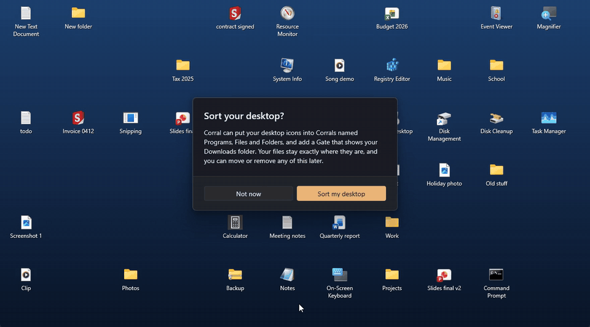
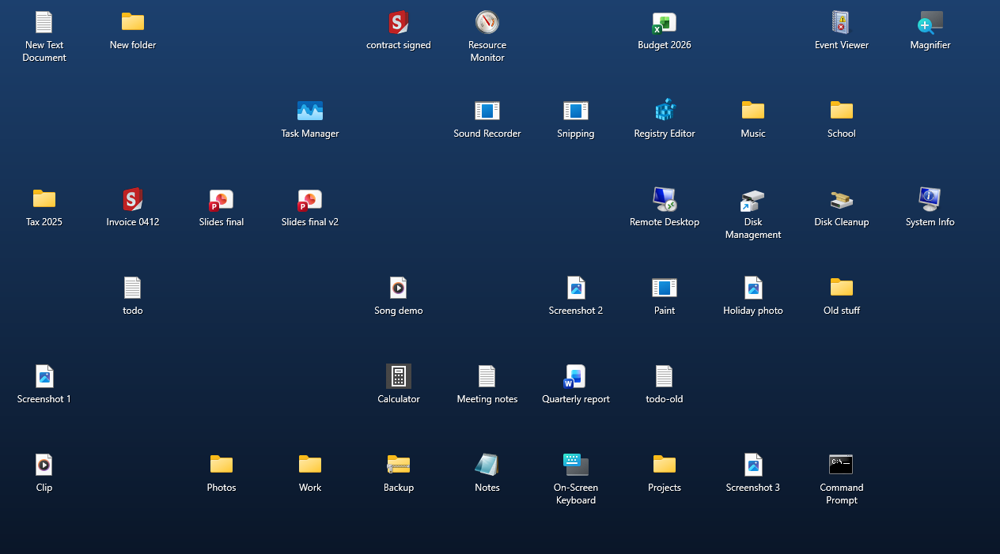
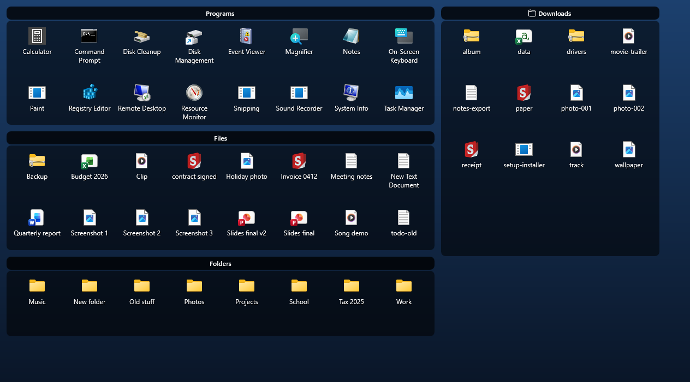
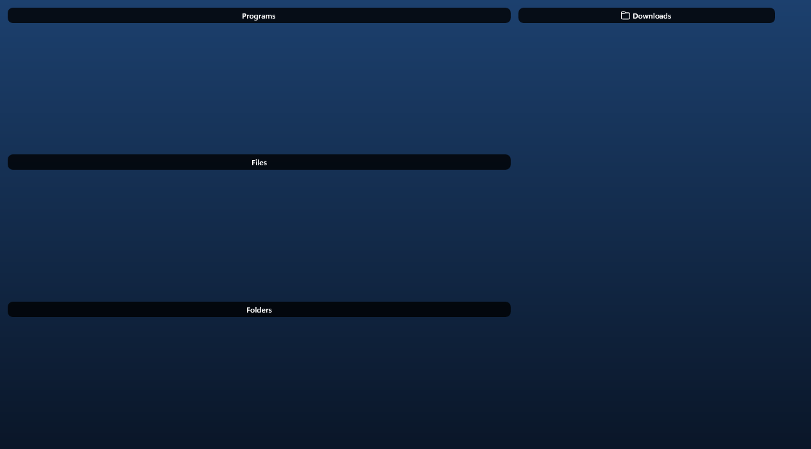
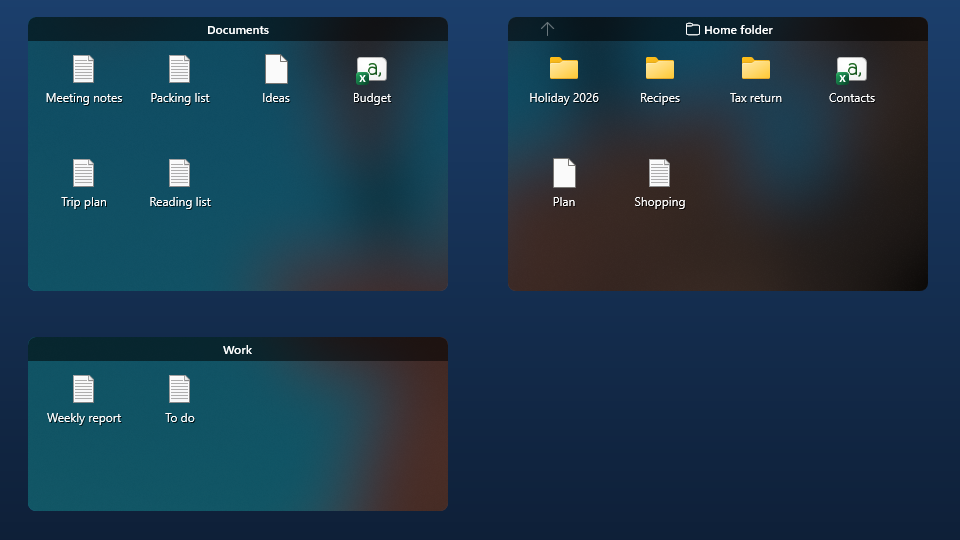
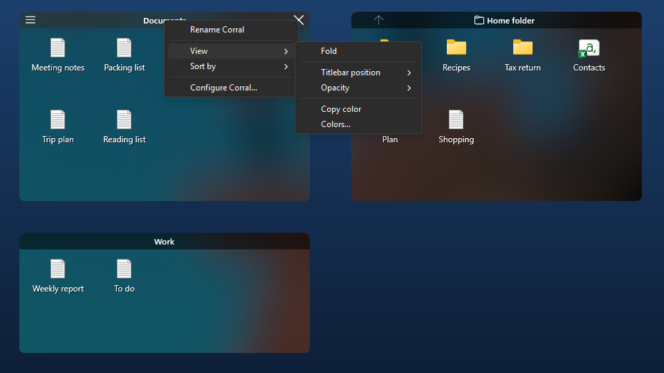
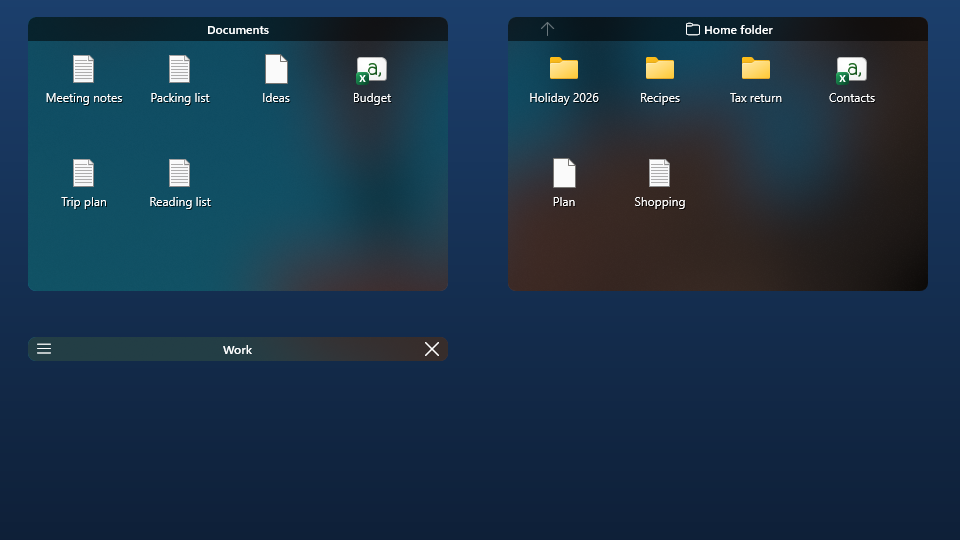
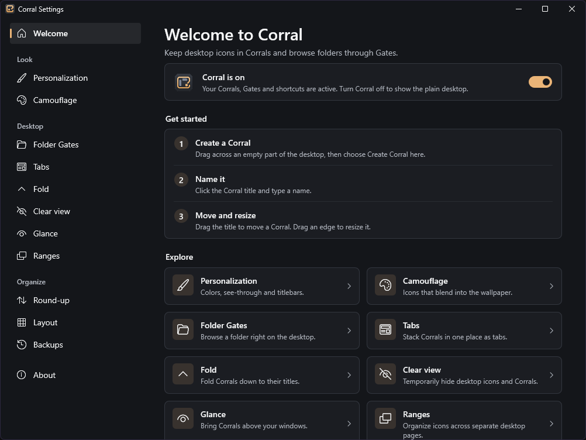
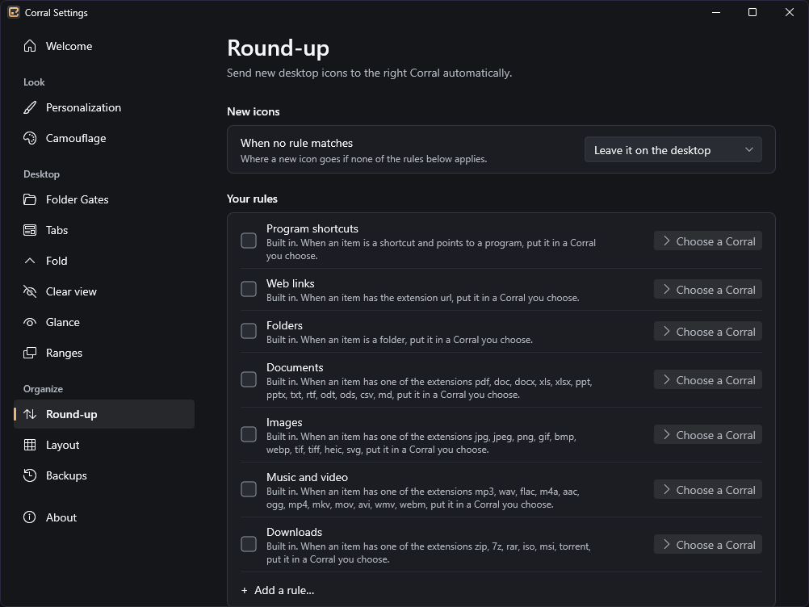

# Corral

**A desktop icon organizer for Windows, built as a personal project with AI coding agents.**

**Status: alpha.** The features below work and have been tested live on Windows 11, but expect
rough edges; see [Known issues](#known-issues). Download: [v0.2.1-alpha](https://github.com/threppo/corral/releases/tag/v0.2.1-alpha).



57-second demo with sample files ([MP4](https://github.com/threppo/corral/releases/download/v0.1.0-alpha/corral-demo.mp4), [how it was recorded](docs/showcase/demo-script.md)).

## Before and after

| | |
| --- | --- |
|  |  |
| Before: icons wherever they landed | After: sorted in one click on first run |
|  | |
| Folded: just the title bars, until you need them | |

Sample files on a plain gradient, the same 41 items in all three.

## What's in it

Corral keeps the desktop tidy with a set of building blocks you arrange yourself:

- **Sort on first run**: Corral offers once to put your icons into Programs, Files and Folders
  Corrals and add a Gate for your Downloads folder. Say no and it stays out of the way.
- **Corrals**: movable, resizable containers that hold desktop items.
- **Folder Gates**: a corral that shows a folder and lets you browse it without opening a window.
- **Views**: every Corral and Gate shows its items as Icons, List or Details (sortable, resizable
  columns: Name, Size, Type, Date modified).
- **Tabs**: stack several Corrals and Gates in one place and switch between them. Flat, Segmented
  and Rounded give each tab its own full-width title bar with its own menu, close and Up buttons;
  Menu only lists the tabs from an arrow on the title. Single Corrals follow the same style, so
  they match. Pick a style in Settings or from a tab set's menu under Tabs > Tab style.
- **Camouflage**: icons take on the colours of the wallpaper behind them, for a quieter desktop.
- **Round-up**: rules that send new desktop items to the right corral, with a preview before sorting.
- **Saved desk setups**: corral placements remembered per monitor setup and restored when it returns.
  Without them, a Corral moved to fit a smaller screen goes back when the bigger one returns.
- **Start with Windows**: a Settings option that starts Corral as soon as you log in, ahead of other startup apps.
- **Turn Corral off**: from Settings, which hides Corrals and Gates and gives the desktop icons back to Windows.
  Turn it back on from the notification-area icon or Settings; your layout and files are not touched.
- **Clear view**: double-click the desktop to hide corrals and icons, and again to bring them back.
- **Fold**: roll a corral up to just its title bar.
- **Ranges**: separate desktop pages you switch between.
- **Glance**: bring all corrals above your windows with a hotkey.

Sorting, arranging items in corrals and Round-up never move, rename or delete your files; corrals only
reference items on your desktop. Dropping files onto a Folder Gate is an ordinary Windows move
into that folder.

## More screenshots



| | |
| --- | --- |
|  |  |
| The Corral menu | A folded Corral |
|  |  |
| Settings: Welcome | Settings: Round-up rules for new icons |

[Settings: Glance shortcuts](assets/screenshots/settings-glance.png). All screenshots use throwaway
sample files.

## My role and AI workflow

I built Corral between 10 and 29 October 2026 with Claude Code and Codex, in a private repository
(about 690 commits). This public repository starts from a single snapshot of that work, so its
history is short on purpose.

**What I did**

- Set the goal and the limits: a native Windows app in Rust that must never lose or move a user's
  files without them asking.
- Made the product decisions the agents brought to me, for example: Corral's own names for every
  feature, the amber accent and the app icon (picked from design options), size snapping off by
  default because resizing felt too snappy, Corrals using the desktop's icon spacing, allowing a
  keyboard hook so Glance shortcuts work everywhere, and the GPL licence.
- Tested by hand in the first week: preview sessions and a two-monitor session in desktop mode
  (switching displays with Win+P, changing resolution), and reported what I saw. One of those
  reports is the [case study](docs/showcase/case-study.md).
- From 13 October on, approved or held every merge into the main branch, after the agents' tests
  and reviews. I read the summaries, test results and review findings; I did not review the
  code line by line, and I did not write the Rust code myself.

**What the agents did**

- **Claude Code** was the lead: it planned the work, split it into written briefs (files it may
  touch, what "done" means, which tests to run), wrote most of the code, ran the test suite, and
  merged branches after my OK. The final live test passes were run by Claude Code itself, with a
  guarded driver script that refuses any click or screenshot outside Corral's own windows and
  works only with scratch files.
- **Codex** took briefs as a worker, each on its own branch in a separate git worktree so parallel
  tasks never edited the same files, and did independent read-only reviews. Any change that can
  move or delete files needed such a review before merging.
- Every live test session was written up: what passed, what failed, which branch fixed it and
  what was still open. The [verification record](docs/showcase/verification.md) separates what was
  checked fresh on this code from older results, and what I tested from what the agents tested.

Also here: a [45–60 second demo plan](docs/showcase/demo-script.md) using only sample files.

## Requirements

- Windows 11, 64-bit (x64). The code also targets Windows 10, but that has not been tested.

## Building

You need a Rust toolchain targeting `x86_64-pc-windows-gnu`.

```powershell
cargo build --release
```

The executable is written to `target\release\corral.exe`. `cargo test` runs the unit and
integration tests.

Optionally, `scripts\build.ps1` wraps `cargo` (`-Release`, `-Test`, `-Check`). It uses a
portable Rust toolchain if one is found at the path given by the `CORRAL_PORTABLE_RUST`
environment variable, and otherwise uses `cargo` from your `PATH`.

## Running

Download `corral.exe` from the [v0.2.1-alpha release](https://github.com/threppo/corral/releases/tag/v0.2.1-alpha)
and run it. There is nothing to install.

1. It opens in a preview window showing your own desktop items, and your real desktop stays as it
   is. The first time, it asks whether to sort them.
2. When you like what you see, click **Use on my desktop** at the top of the preview. Your
   arrangement comes with you.
3. To keep it, turn on **Start with Windows** in Settings. You can turn Corral off there too, which
   gives the desktop icons back to Windows.

From a command line, `corral.exe --desktop` goes straight to the real desktop.

## Known issues

- With two Folder Gates on the same folder, selecting an item highlights it in both.
- The **Use on my desktop** bar at the top of the preview is a plain white Windows menu bar, on an
  otherwise dark window.
- Corrals sorted in the preview keep the preview's size on the real desktop, so on a large screen
  they start out smaller than they need to be. Resize them, or sort on the real desktop instead.
- The release `corral.exe` is not code-signed, so Windows SmartScreen may warn before the first run.

## Settings and layouts

Settings and corral layouts are stored in a `Corral` folder under `%APPDATA%`
(`settings.json`, `layout.json`, backups). The About page in the settings window shows the
exact locations in use.

## Licence

Corral is free software under the GNU General Public License, version 3 or (at your
option) any later version. See [LICENSE](LICENSE). Licences of the third-party components
it uses are listed in [THIRD-PARTY-NOTICES.md](THIRD-PARTY-NOTICES.md).
